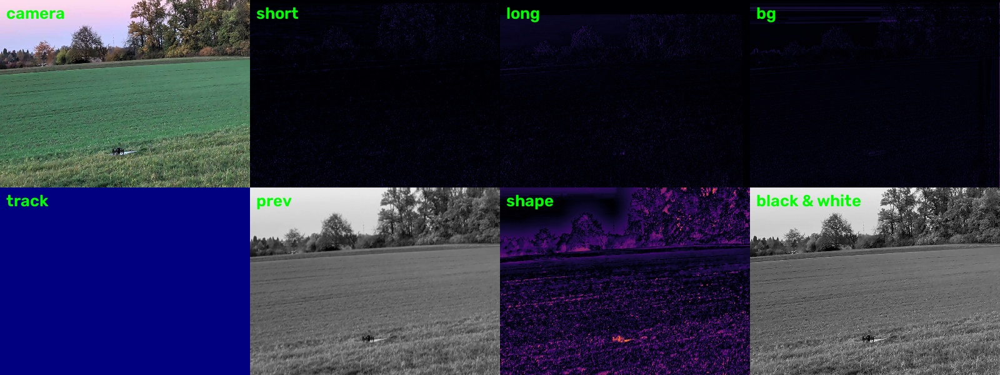

# Drone detection and tracking

Finds and tracks up to 2 drones in 1920x1080 video and writes one result file per video:
`frame,id,left,top,width,height,confidence` (frames start at 1, ids are 1 or 2 and stay the same when a drone leaves and comes back).
Target: real time (50 fps or more) on a Raspberry Pi with the AI HAT+ (Hailo-8, 26 TOPS).

## How it works

1. **Detector**: YOLO11n ([SkyGuardAI/drone-detection-yolov11](https://huggingface.co/SkyGuardAI/drone-detection-yolov11), MIT), being fine-tuned on our data.
2. **Tracker** (`tracker.py`): Kalman filter + two-threshold matching, at most 2 ids, re-identifies a returning drone by appearance (colour/brightness histogram, shape) and position.
3. **Trajectory crops** (`stack.py`): where the tracker expects a drone, a zoomed crop is checked again, which finds small drones the full-frame pass misses.
4. **Extra input layers** (`layers.py`, for the multi-channel model B, not trained yet): short / long / background difference (camera-shake compensated), tracker map, previous frame, brightness shape.
5. **Motion detector** (`motion_live.py`): kept for the views; motion crops are off by default (they did not improve the score).

## Scores on the 3 practice videos (IoU 0.5)

| Setup | MOTA | IDF1 | Precision | Recall | ID switches |
|---|---|---|---|---|---|
| SkyGuard + tracker | 0.843 | 0.916 | 0.983 | 0.858 | 0 |
| + trajectory crops | 0.855 | 0.916 | 0.980 | 0.873 | 1 |
| + boxes clipped to the frame (default, team evaluate.py) | 0.862 | 0.920 | 0.987 | 0.873 | 1 |

## Setup

    python -m venv .venv && source .venv/bin/activate
    pip install -r requirements.txt

Put the pretrained weights at `../pretrained/drone-detection-yolov11/best.pt` (download from the Hugging Face link above).
Data is not in this repo: `../test_sample_clean/<video>/video.mp4 (+ gt/gt.txt)`, `../hackathon_dataset`, Anti-UAV-RGBT.

## Run

Demo with switchable views:

    python demo.py ../test_sample_clean/test_6_hard_PXL_20261113_154422245_hard/video.mp4 --show
    python demo.py 0 --show            # live camera

Keys: 1 camera, 2 difference, 3 motion mask, 4 four-way view, 5 short diff, 6 long diff, 7 background diff,
8 tracker map, 9 previous frame, b brightness shape, 0 all layers, t trajectory, m motion crops, p trajectory crops,
o helper boxes, space pause, q quit.

Score all practice videos:

    python run_video.py --weights <best.pt> --videos ../test_sample_clean --out preds/x --imgsz 1280 --conf 0.01
    python pipeline.py --videos ../test_sample_clean --dets preds/x --out preds/x_trk --weights <best.pt> --no-motion
    python eval_track.py --gt ../test_sample_clean --pred preds/x_trk

Pi-style timing (threaded reader / model / tracker): `python pi_run.py --help`.

## Training

    python prep_data.py --src ../hackathon_dataset --dst drone_data          # single class, hard links
    python convert_antiuav.py --help                                          # Anti-UAV-RGBT videos -> YOLO frames
    python finetune.py --weights ../pretrained/drone-detection-yolov11/best.pt --data drone_hack.yaml --epochs 10 --imgsz 640
    python finetune.py --weights ../pretrained/drone-detection-yolov11/best.pt --data drone_ft.yaml   # hackathon + Anti-UAV

`mlayer.py` / `train.py` are an earlier colour-vs-grayscale experiment, kept for reference.

## Views

